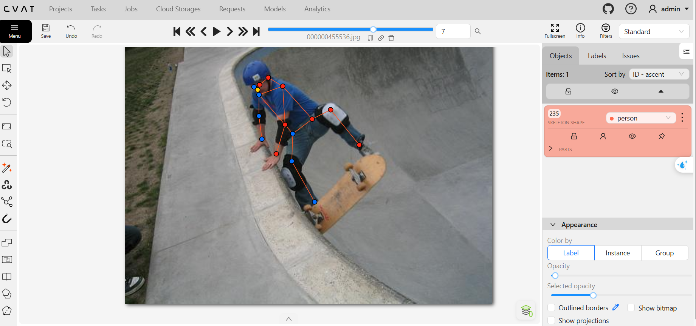
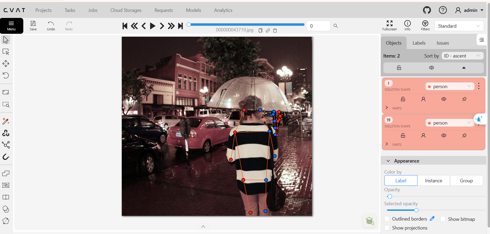
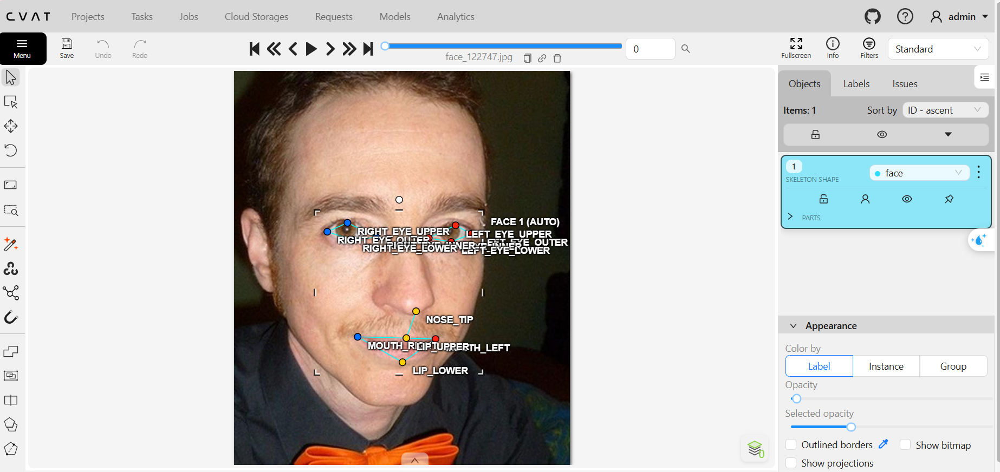
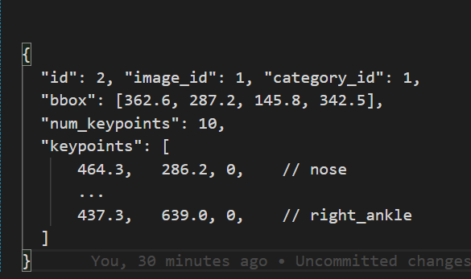

# Báo cáo cá nhân — TaDucThang-2A202603163

Dữ liệu: 12 ảnh người COCO val2017 (Lin et al., 2014) và 8 ảnh chân dung Wikimedia Commons, chỉ dùng trong lớp.

## 0. Thông tin học viên

- Họ tên: Tạ Đức Thắng
- MSSV: 2A202603163
- Email: tduc34075@gmail.com
- Link repository: https://github.com/Dthang-zz/K5-L2A-TaDucThang-2A202603163-KeypointPose-Student.git
- Phiên bản CVAT (Help → About): 2.82.1
- Máy: hệ điều hành Windows 11 Home · RAM 8 GB · chạy CVAT chế độ đầy đủ
- Bộ ảnh (`src/exports/assignment.json` do `lab.py setup` tạo): có
- Giờ bắt đầu: 16:00
- Giờ kết thúc: 19:15

## 1. Kiểm tra label (CP0)

| Label    | Kiểu     | Số điểm | Tên điểm đúng bảng của lab? | Đúng thứ tự? | Số cạnh |
| -------- | -------- | ------: | --------------------------- | ------------ | ------: |
| `person` | Skeleton |      17 | Có                          | Có           |      19 |
| `face`   | Skeleton |      13 | Có                          | Có           |      13 |

Mẫu `person` dựng theo người quay mặt về camera (các điểm `left_*` nằm bên phải khung mẫu)? Có

Cách đổi cờ `occluded` / `outside` cho **một điểm** trên phiên bản CVAT này (một câu):

<!-- TODO: tự viết đúng thao tác bạn đã làm, ví dụ: rê chuột vào đúng một điểm của skeleton, chuột phải (hoặc chọn điểm trong danh sách Objects bên phải, mở rộng skeleton) rồi bấm biểu tượng occluded / outside của riêng điểm đó; không dùng phím H (hidden). -->

## 2. Số lượng đã gán và thời gian (CP1, CP2)

| Nhóm ảnh   | Số ảnh | Số skeleton đã gán | Số người dưới 60 px (không gán) | Số poster / gương / màn hình bỏ qua | Thời gian (phút) |
| ---------- | -----: | -----------------: | ------------------------------: | ----------------------------------: | ---------------: |
| `easy`     |      5 |                  5 |                   <!-- TODO --> |                       <!-- TODO --> |    <!-- TODO --> |
| `occluded` |      3 |                  6 |                   <!-- TODO --> |                       <!-- TODO --> |    <!-- TODO --> |
| `back`     |      2 |                  4 |                   <!-- TODO --> |                       <!-- TODO --> |    <!-- TODO --> |
| `small`    |      1 |                  3 |                   <!-- TODO --> |                       <!-- TODO --> |    <!-- TODO --> |
| `crowd`    |      1 |                  3 |                   <!-- TODO --> |                       <!-- TODO --> |    <!-- TODO --> |
| `faces`    |      8 |                  8 |                               — |                                   0 |    <!-- TODO --> |

- Số ảnh người đã xong ở mốc phút 105: 5 / 10
- Thời gian thực tế (phút): CP1 **60p · CP2 30p** · CP3 20p
- Ảnh tốn thời gian nhất là ảnh nào, vì sao?

- ảnh 000000043968.jpg mất thời gian nhất vì phải sửa lại nhiều lần

## 3. Bảng ca khó (CP1, CP2)

<!-- TODO: TỰ VIẾT mục này (RULES.md: không dùng AI viết hộ mục 3, 4, 7). -->

Mỗi điểm bạn phân vân một dòng, nhất là phân vân giữa `v = 1` và `v = 0`, hoặc không chắc hướng người.

| Ảnh                           | Người / mặt                                                                                      | Điểm                       | Cờ đã chọn | Phân vân giữa  | Lý do chọn |
| ----------------------------- | ------------------------------------------------------------------------------------------------ | -------------------------- | ---------: | -------------- | ---------- |
| `000000469061.jpg` (occluded) | Người lớn áo trắng, đứng sau em bé                                                               | `right_hip`, `right_knee`  |          1 |
| `v = 1` / `v = 0`             | Bị em bé che, nhưng đùi và ống chân phía dưới vẫn thấy, nối lại được vị trí hông và              |
| gối nên ước lượng chắc        |
| `000000467300.jpg` (occluded) | Chú rể (sau cô dâu)                                                                              | `left_elbow`, `left_wrist` |          1 | `v = 1` / `v = |
| 0`                            | Tay trái bị cô dâu che, nhưng bàn tay cầm dao cùng cô dâu thấy rõ, nên đoán chắc khuỷu và cổ tay |

|
| `000000467300.jpg` (occluded) | Chú rể | `left_knee`, `left_ankle`, `right_ankle` | 0 | `v = 1` / `v
= 0` | Chân khuất hoàn toàn sau bàn và khăn trải; ba người ước lượng sẽ ra ba chỗ khác nhau nên để `out
side` |
| `000000522889.jpg` (crowd) | Cô gái chơi tennis | `left_knee` | 1 | `v = 1` / `v = 0` | Gối chân co p
hía sau bị chân trụ che; nối từ đùi trái tới ống chân đang đá ra sau thì vị trí gối rõ |

## 4. Bảng tự review (CP3)

<!-- TODO: TỰ VIẾT mục này (RULES.md: không dùng AI viết hộ mục 3, 4, 7). -->

Đi từ ảnh cuối về ảnh đầu. 5 ảnh người (ít nhất 2 ảnh `back` hoặc `crowd`) và 3 ảnh mặt. Ít nhất 8 dòng, kể cả dòng `ok`. Ghi lỗi trước, sửa sau.

Mã lỗi dùng đúng một trong: `lr_swap`, `vis_flag`, `position`, `missing`, `extra`, `ok`.

| Ảnh                          | Người / mặt | Điểm       | Mã lỗi     | Ghi chú                                                                                                       | Đã sửa?   |
| ---------------------------- | ----------- | ---------- | ---------- | ------------------------------------------------------------------------------------------------------------- | --------- | --- |
| -                            |             |            |            |                                                                                                               |           |     |
| `face_255797.jpg` (kính râm) | Mặt         | 8 điểm mắt | `vis_flag` | Ban đầu cả 8 điểm mắt `v = 2` dù mắt sau tròng kính tối; đã đổi 7 điểm sang `occluded`, còn `right_eye_inner` | Một phần  |
| `face_79591.jpg` (nghiêng)   | Mặt         | 13 điểm    | `ok`       | Mặt nghiêng nhưng cả hai mắt vẫn thấy rõ, `v = 2` đúng; trái/phải đúng                                        | Không cần |

Tổng hợp số lỗi theo mã:

|             `lr_swap` | `vis_flag` | `position` | `missing` | `extra` | `ok` |
| --------------------: | ---------: | ---------: | --------: | ------: | ---: |
| 1 │ 4 │ 0 │ 1 │ 1 │ 2 |

Điểm còn phân vân giữa `v = 1` và `v = 0` (ghi cả hai lựa chọn và lý do chọn):

- Điểm tóc che mắt. Chọn v=1 vì vẫn xác định được

## 5. Kiểm file xuất và kết quả tự kiểm (CP4)

Tự kiểm tay trong file JSON:

| File                     | Người / mặt kiểm (ảnh, thứ tự)          | Số phần tử `keypoints` | Điểm `outside` ra `v = 0`, `occluded` ra `v = 1`? | `num_keypoints` khớp?    |
| ------------------------ | --------------------------------------- | ---------------------: | ------------------------------------------------- | ------------------------ |
| `TaDucThang_persons.zip` | `000000043719.jpg`, người 1 (quay lưng) |                     51 | Có: 5 điểm mặt `outside` → `v = 0`                | Có: 12 = số điểm `v > 0` |
| `TaDucThang_persons.zip` | `000000043968.jpg`, người 1             |                     51 | Có: `left_ear` `occluded` → `v = 1`               | Có: 17                   |
| `TaDucThang_faces.zip`   | `face_255797.jpg` (kính râm)            |                     39 | Có: điểm mắt sau kính `occluded` → `v = 1`        | Có: 13                   |

Sau khi xuất, CVAT ghi `occluded` thành `v = 1` và `outside` thành `v = 0`. Tọa độ của điểm `outside` trong file là `0, 0` hay tọa độ cũ? Tọa độ cũ (CVAT 2.x giữ nguyên; không ảnh hưởng vì điểm `v = 0` bị bỏ qua khi huấn luyện và khi chấm).

Hai job đã chuyển sang completed trên CVAT? <!-- TODO: Có / Không -->

Dán phần **TÓM TẮT** in ra từ `src/check_submission.py`:

```text
- File person: TaDucThang_persons.zip
  Số ảnh: 12 · số skeleton `person`: 21 · mỗi annotation 51 số
  Skeleton theo ảnh: 000000043719=2, 000000043968=1, 000000163118=2, 000000269462=3, 000000294329=1, 000000324953=2, 000000336477=1, 000000455536=1, 000000467300=2, 000000469061=2, 000000522889=3, 000000564304=1
  Cờ v: v=2 282 (79%) · v=1 17 (5%) · v=0 58 (16%)
  num_keypoints trung bình: 14.2
- File face: TaDucThang_faces.zip
  Số ảnh: 8 · số skeleton `face`: 8 · mỗi annotation 39 số
  Skeleton theo ảnh: face_122747=1, face_137371=1, face_255797=1, face_380754=1, face_41666=1, face_469647=1, face_496353=1, face_79591=1
  Cờ v: v=2 93 (89%) · v=1 11 (11%) · v=0 0 (0%)
  num_keypoints trung bình: 13.0
- Ghi chú: 58 điểm v = 0 vẫn mang tọa độ cũ (CVAT 2.x xuất như vậy; chuẩn COCO ghi 0, 0). Không phải lỗi: điểm v = 0 bị bỏ qua khi huấn luyện và khi chấm.
- Số [LỖI]: 0 · số [CẢNH BÁO]: 1
Kết quả: ĐẠT (đọc lại từng cảnh báo ở trên)
```

Các `[CẢNH BÁO]` còn giữ nguyên và lý do:

- `000000522889.jpg #1: cặp ankle nằm ngược phía so với các cặp còn lại.` Giữ nguyên: cô gái đang chạy, chân trái co và đá chéo ra sau về phía bên trái ảnh, còn chân phải là chân trụ phía trước. Tôi đã kiểm bằng cách lần từ từng bên hông xuống đùi, gối, cổ chân; đây là chân bắt chéo thật, không phải `lr_swap`. Gối trái bị chân phải che nên để `occluded`.

## 6. Ảnh chụp màn hình

1. Label `person` trong label constructor (đủ 17 điểm có tên):

   

2. Một người quay lưng đã gán, cờ đã đặt:

   

3. Một khuôn mặt đã gán 13 điểm, phóng to vùng mắt:

   

4. Một đoạn JSON xuất của một người:

   

Nguồn ảnh: COCO val2017 / Wikimedia Commons.

## 7. Tự đánh giá

<!-- TODO: TỰ VIẾT mục này (RULES.md: không dùng AI viết hộ mục 3, 4, 7). -->

1. Lỗi bạn mắc nhiều nhất hôm nay, và cách bạn sẽ tránh ở dự án thật:
   - Lỗi xác định left, right, các hình bị che khó xác định. Nhìn kỹ hơn, luôn đọc kỹ guideline.

2. Một quy tắc bạn đề xuất thêm vào guideline (kèm ảnh ví dụ nếu có):
   - Tai bị tóc che ở người quay lưng: khi nào v=1, khi nào v=0?
   - Khi sửa trái/phải phải đổi cả chuỗi hông → gối → cổ chân, không chỉ một cặp.

3. Nhãn của bạn đi vào model ở đâu? Chọn một lỗi bạn đã sửa và nói nó sẽ làm model học sai thế nào (heatmap, trọng số trong loss, hay bước lật ảnh):
   - lỗi xác định chân left, right:
   * Bước lật ảnh để tăng dữ liệu: khi lật ngang ảnh, tên left*\* và right*\* được đổi cho nhau. Nếu nhãn gốc đã bị đổi trái/phải thì sau khi lật vẫn sai. Model nhận tín hiệu mâu thuẫn và học nhầm trái/phải.

## 8. Khó khăn và lỗi kỹ thuật

- Máy RAM 8 GB, chạy CVAT đầy đủ cùng model trên CPU nên khá chậm.
- Khó nhất khi sửa: đổi trái/phải hai chân ở `000000043968.jpg` (người trượt tuyết). Lần sửa đầu tôi chỉ đổi gối mà chưa đổi cổ chân, nên hai chân bắt chéo thành hình chữ X; phải đổi lại cả cặp gối và cặp cổ chân.
<!-- TODO: thêm khó khăn khác của bạn nếu có -->

<!-- Ghi chú cho bạn trước khi nộp: script đếm 21 skeleton người; README nói bộ ảnh có 20 người cần gán. Kiểm lại xem có skeleton nào thừa không (ví dụ người cao dưới 60 px), hoặc ghi lý do giữ nguyên. -->

## Bonus (nếu làm)

### B1 — 3 ảnh người khó thêm

| Ảnh | Số skeleton | Số người dưới 60 px | Ca khó nhất |
| --- | ----------: | ------------------: | ----------- |
|     |             |                     |             |
|     |             |                     |             |
|     |             |                     |             |

Kết quả `src/check_submission.py` cho `HoVaTen_bonus_persons.zip`:

```text
(dán ở đây)
```

### B2 — 5 ảnh khuôn mặt đen trắng / hồng ngoại

Ảnh không màu khó hơn ở điểm nào? Kính râm trên ảnh hồng ngoại có còn là `v = 1` không?

- Ảnh không màu làm giảm thông tin thị giác, khiến việc xác định ranh giới và vị trí Keypoint khó hơn. Đối với kính râm trên ảnh hồng ngoại, cần đánh giá khả năng xác định vị trí Keypoint thay vì chỉ dựa vào việc có vật che. Nếu mắt bị che nhưng vẫn ước lượng được vị trí thì gán v = 1; nếu không xác định được thì gán v = 0.

### B3 — Model so với nhãn của tôi (không tính điểm)

- Demo đã dùng:
- Ảnh đã thử:

1. Model có trả điểm cho khớp bị che, hay khớp ngoài ảnh không? Confidence ở các điểm đó thế nào?

   ...

2. Với người quay lưng, model có đổi trái/phải không?

   ...

3. Bộ điểm của model có giống 17 điểm COCO không?

   ...

## 9. Tài liệu tham khảo và công cụ AI đã dùng
